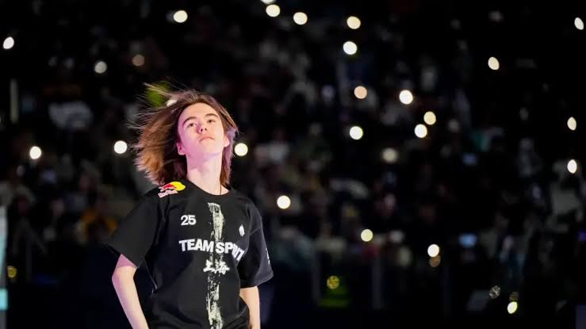
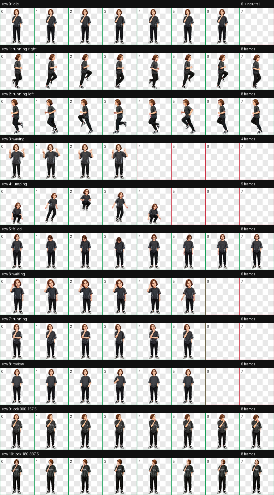

# donk — Codex Desktop Pet

[中文](README.md)

> This stage photograph is included solely for README display. It is not a pet asset and is not covered by this repository's CC BY-NC 4.0 license. Copyright and any related likeness, team, tournament, or trademark rights remain with their respective rightsholders.

An unofficial, non-commercial Codex v2 custom desktop pet inspired by CS2 player donk. Its default idle is the iconic shush pose, with signature hands-in-pockets, thumbs-up, and listening poses.

## Hope!!

Here’s hoping donk wins a Major championship in the second half of 2026 and leaves everyone in awe.

## Quick install

The pet itself needs only the two files in this repository's root: pet.json and spritesheet.webp.

### macOS / Linux

Run this from the repository root:

~~~sh
codex_home="$CODEX_HOME"
if [ -z "$codex_home" ]; then codex_home="$HOME/.codex"; fi
pet_dir="$codex_home/pets/donk"
mkdir -p "$pet_dir"
cp pet.json spritesheet.webp "$pet_dir/"
~~~

Restart Codex, or refresh custom pets in Settings and select donk. Back up the destination first if a pet with the same id already exists.

### Windows PowerShell

~~~powershell
$codexHome = if ($env:CODEX_HOME) { $env:CODEX_HOME } else { Join-Path $HOME ".codex" }
$petDir = Join-Path $codexHome "pets\donk"
New-Item -ItemType Directory -Force -Path $petDir
Copy-Item pet.json, spritesheet.webp -Destination $petDir -Force
~~~

Restart Codex, or refresh custom pets in Settings and select donk.

## Format and compatibility

- spriteVersionNumber: 2
- spritesheet.webp: 1536 × 2288 px RGBA WebP
- Atlas: 8 columns × 11 rows; 192 × 208 px per cell
- Nine standard animation rows and sixteen continuous look directions

## Motion preview

- Default idle: the iconic shush pose
- Review: hands in pockets, followed by a thumbs-up
- Waiting: listening with a hand cupped to the ear
- Running: the chin-thinking pose
- Waving: a V sign and an OK sign
- Also includes left/right running, jumping, and a restrained failed reaction

previews/ contains nine animated GIFs for quickly previewing the standard states.

## Release contents

| File | Purpose |
| --- | --- |
| pet.json | Codex v2 pet metadata |
| spritesheet.webp | The animation atlas required for installation |
| contact-sheet.png | An overview of all motions |
| previews/ | Nine animated GIF previews |
| SHA256SUMS | SHA-256 checksum manifest for this release |

## Verify

From the repository root, run:

~~~sh
shasum -a 256 -c SHA256SUMS
~~~

## License and disclaimer

The original pet artwork in this repository is released under [CC BY-NC 4.0](LICENSE). This license covers only rights held by the creator; it does **not** grant rights to donk’s name or likeness, or to any team, tournament, or brand trademarks.

This is an unofficial, non-commercial fan project. It is not affiliated with, endorsed by, or sponsored by donk, any esports team or tournament organizer, Valve, or OpenAI.
