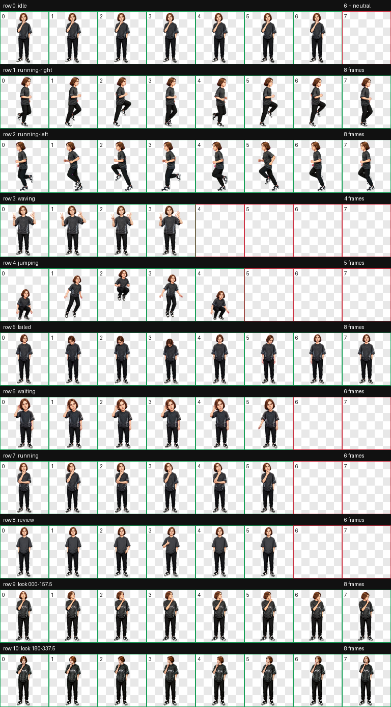

# donk — Codex 桌面宠物

[English](README.en.md)

> 这张舞台照仅用于 README 展示，不属于宠物资源，也不包含在本仓库的 CC BY-NC 4.0 许可中。照片版权及相关肖像、队伍、赛事和商标权利均归各自权利人所有。

一个非官方、非商业的 Codex v2 自定义桌面宠物，灵感来自 CS2 选手 donk。默认待机采用经典“噤声”手势，并加入插兜、点赞、侧耳倾听等标志性动作。

## 快速安装

宠物实际只需要根目录的两个文件：pet.json 和 spritesheet.webp。

### macOS / Linux

在本仓库根目录执行：

~~~sh
codex_home="$CODEX_HOME"
if [ -z "$codex_home" ]; then codex_home="$HOME/.codex"; fi
pet_dir="$codex_home/pets/donk"
mkdir -p "$pet_dir"
cp pet.json spritesheet.webp "$pet_dir/"
~~~

随后重启 Codex，或前往设置中的宠物页面刷新自定义宠物并选择 donk。如已有同名宠物，请先备份目标目录。

### Windows PowerShell

~~~powershell
$codexHome = if ($env:CODEX_HOME) { $env:CODEX_HOME } else { Join-Path $HOME ".codex" }
$petDir = Join-Path $codexHome "pets\donk"
New-Item -ItemType Directory -Force -Path $petDir
Copy-Item pet.json, spritesheet.webp -Destination $petDir -Force
~~~

然后重启 Codex，或在设置中的宠物页面刷新自定义宠物并选择 donk。

## 格式与兼容性

- spriteVersionNumber: 2
- spritesheet.webp：1536 × 2288 px、RGBA WebP
- 图集：8 列 × 11 行；每格 192 × 208 px
- 9 个标准动画行和 16 个连续观察方向

## 动作预览

- 默认待机：经典“噤声”手势
- Review：双手插兜，随后点赞
- Waiting：侧耳倾听
- Running：托腮思考
- Waving：V 手势与 OK 手势
- 另含左右跑步、跳跃与克制的失败反应

previews/ 内含 9 个动画 GIF，用于快速预览各标准状态。

## 发布内容

| 文件 | 用途 |
| --- | --- |
| pet.json | Codex v2 宠物元数据 |
| spritesheet.webp | 实际安装所需的动画图集 |
| contact-sheet.png | 动作总览 |
| previews/ | 9 个动画预览 GIF |
| SHA256SUMS | 本次发布文件的 SHA-256 校验清单 |

## 校验

在仓库根目录执行：

~~~sh
shasum -a 256 -c SHA256SUMS
~~~

## 粉丝心愿

愿 donk 在 2026 年下半年的 Major 赛场登顶，技惊四座。

## 许可与免责声明

本仓库中的原创宠物图像以 [CC BY-NC 4.0](LICENSE) 发布；该许可仅涵盖作者拥有的权利，**不**授予 donk 的姓名或肖像权，也不授予任何队伍、赛事或品牌商标权。

这是非官方、非商业的粉丝作品，与 donk、任何电竞队伍或赛事组织者、Valve 和 OpenAI 均无关联、认可或赞助关系。
